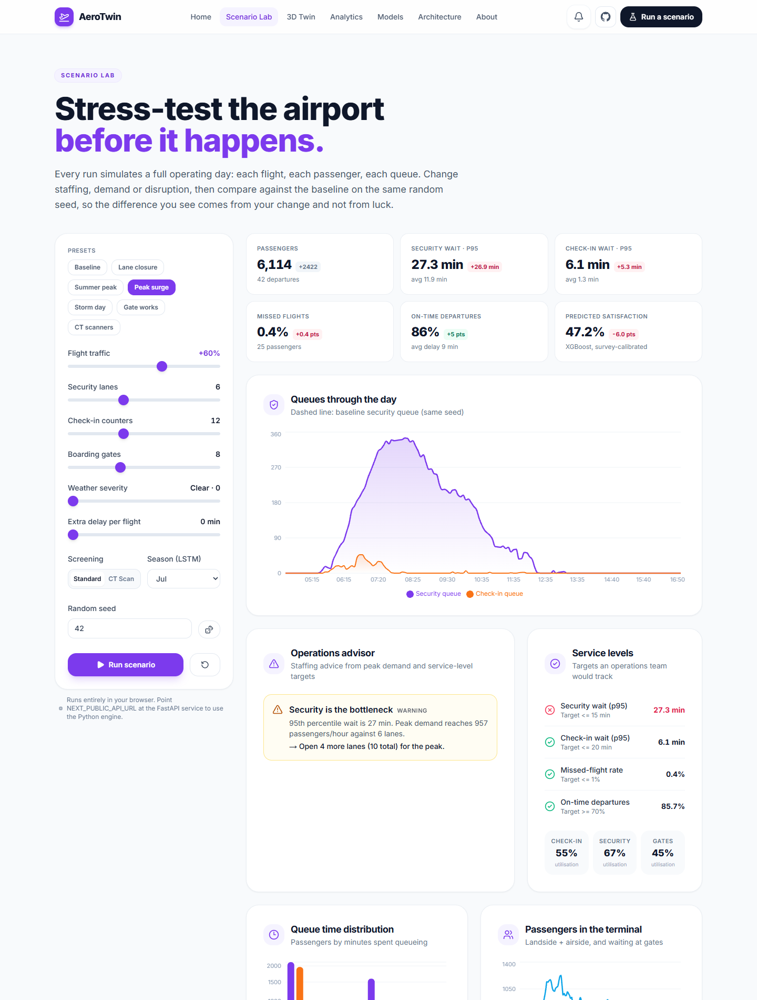
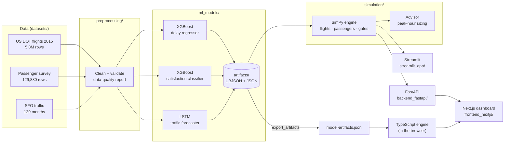
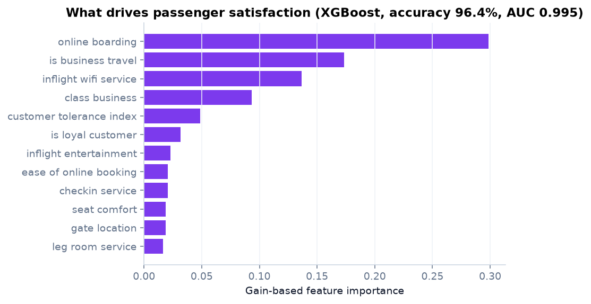
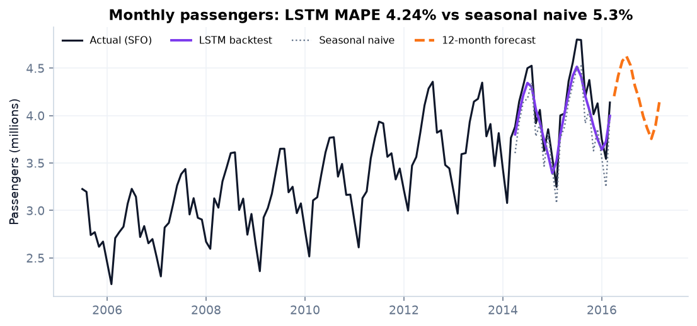
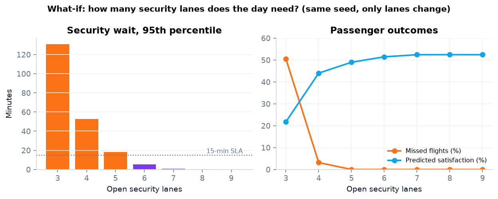
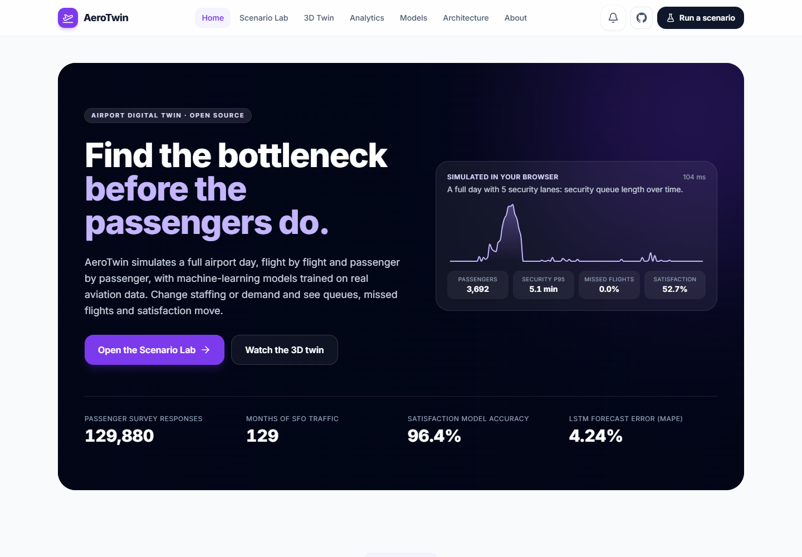
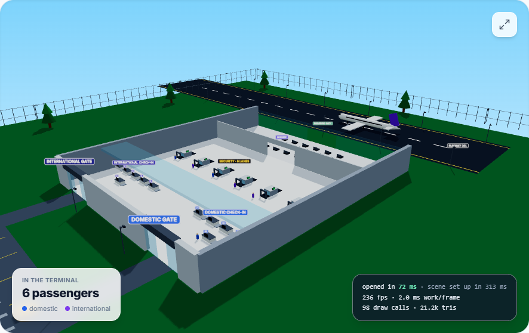
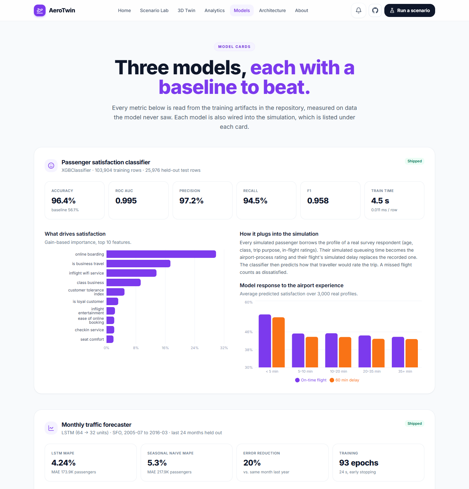
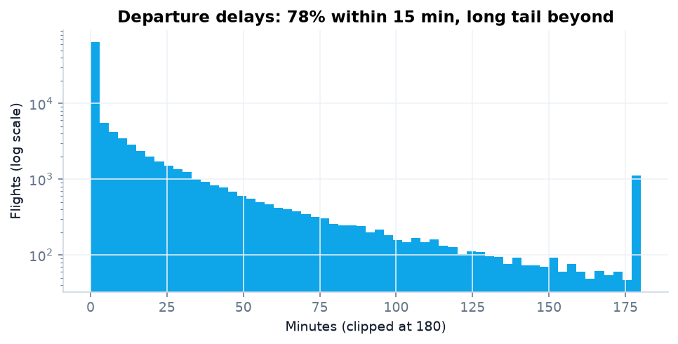

<div align="center">

# AeroTwin: Airport Digital Twin Simulation

**A discrete-event digital twin of an airport terminal, built with SimPy and driven by machine-learning models trained on real aviation data.**
Close a security lane, add 50% more flights or bring in a storm, and watch queues, missed flights and passenger satisfaction respond.

[](https://github.com/Kianis534/airport-digital-twin-simulation/actions/workflows/ci.yml)
[](https://github.com/Kianis534/airport-digital-twin-simulation/actions/workflows/deploy-pages.yml)
[](LICENSE)


### [▶ Live demo](https://kianis534.github.io/airport-digital-twin-simulation/) · [Scenario Lab](https://kianis534.github.io/airport-digital-twin-simulation/what-if/?preset=peak-surge) · [API docs](#api-reference) · [Quick start](#quick-start)



</div>

---

## Contents

- [What this is](#what-this-is)
- [Highlights](#highlights)
- [Live demo](#live-demo)
- [How it works](#how-it-works)
  - [Architecture](#architecture)
  - [The simulation model](#the-simulation-model)
  - [The machine-learning models](#the-machine-learning-models)
  - [How the models plug into the simulation](#how-the-models-plug-into-the-simulation)
- [Results](#results)
- [Screenshots](#screenshots)
- [Tech stack](#tech-stack)
- [Project structure](#project-structure)
- [Quick start](#quick-start)
- [Configuration](#configuration)
- [Data and model training](#data-and-model-training)
- [API reference](#api-reference)
- [Testing and quality](#testing-and-quality)
- [Deployment](#deployment)
- [Limitations and roadmap](#limitations-and-roadmap)
- [Contributing](#contributing) · [License](#license) · [Author](#author) · [Acknowledgements](#acknowledgements)

---

## What this is

Airports size check-in, security and gates months ahead, but demand, weather and staffing change daily. Averages hide the peaks where queues actually form, so operators use **simulation** to test decisions before making them.

AeroTwin is an end-to-end version of that tool:

1. **Data pipeline** that cleans three public datasets: 2015 US flight operations, a 129,880-passenger satisfaction survey, and 11 years of San Francisco International (SFO) traffic.
2. **Machine-learning models**: an XGBoost satisfaction classifier, an LSTM monthly demand forecaster and an XGBoost flight-delay regressor.
3. **SimPy discrete-event engine** that simulates a full operating day: every flight, every passenger and every queue.
4. **FastAPI service** for running scenarios, comparing them and calling the models directly.
5. **Next.js dashboard** with a Scenario Lab, a 3D live twin, live analytics and model cards. It also works without a backend, because a TypeScript port of the engine runs in the browser.
6. **Streamlit app** as a Python-only alternative to the dashboard.

## Highlights

- **A real process model, not a formula.** Flights claim gates, open boarding and close the gate. Passengers arrive on a realistic profile, queue at check-in and security, walk to the gate and board. A passenger who reaches a closed gate misses the flight.
- **Models with measured accuracy.** The satisfaction classifier scores **96.4% accuracy (ROC AUC 0.995)** on 25,976 held-out passengers, against a 56.1% majority baseline. The LSTM forecasts monthly traffic with **4.24% MAPE**, beating a seasonal-naive baseline (5.30%).
- **Fair comparisons.** Baseline and what-if runs share the same random seed (common random numbers), so a difference comes from the lever you changed, not from luck.
- **Advice sized from the peak.** The advisor computes the servers each stage needs from the busiest simulated hour (`ceil(peak rate × service time / 85%)`) and says how many lanes or counters to add.
- **Graceful degradation.** Every model is optional. Without the 565 MB flights file, delays are sampled from 129,880 recorded departures; each result reports which source it used.
- **Two engines that agree.** The Python engine and its TypeScript port share one parameter file, and both test suites check the same behaviour.
- **Production habits.** Typed API schemas, background jobs, Docker images, 65 automated tests, linting, and CI/CD that tests every push and deploys the demo.

## Live demo

**https://kianis534.github.io/airport-digital-twin-simulation/**

The demo is a static site on GitHub Pages, so nothing needs to be installed. Scenarios run in your browser on the TypeScript engine, using parameters, a satisfaction response surface, a delay distribution and a traffic forecast exported from the Python models. To run the Python engine behind the same UI, start the API and set `NEXT_PUBLIC_API_URL` (see [Quick start](#quick-start)).

| Page | What you can do |
| --- | --- |
| [Scenario Lab](https://kianis534.github.io/airport-digital-twin-simulation/what-if/) | Move staffing, traffic, weather and seasonal demand. Compare against the baseline. Presets are shareable, e.g. `?preset=lane-closure`. |
| [3D Twin](https://kianis534.github.io/airport-digital-twin-simulation/simulation/) | A real-time Three.js terminal where passengers walk the process and aircraft board and take off. No model downloads; opened from another page it shows its first frame in roughly 60–70 ms and renders each frame in about 2 ms. The corner overlay shows these timings, measured live. |
| [Analytics](https://kianis534.github.io/airport-digital-twin-simulation/graphs-stats/) | Seven live charts that follow the 3D view. |
| [Models](https://kianis534.github.io/airport-digital-twin-simulation/models/) | Test-set metrics, baselines, feature importance and the LSTM backtest. |
| [Architecture](https://kianis534.github.io/airport-digital-twin-simulation/overview/) | Layers, process model and API endpoints. |

## How it works

### Architecture



Data flows one way: datasets → models → engine → API → UI. Each layer lives in its own folder with its own tests.

### The simulation model

One run simulates an operating day (default: an 8-hour departure window starting 06:00, plus the arrival period before it).

| Stage | Model |
| --- | --- |
| **Schedule** | 3 departures/hour on average, shaped by a morning-peak profile and scaled by the traffic lever and the LSTM seasonal factor. Aircraft of 150/180/220 seats, 72–95% load factor, 30% international. |
| **Arrival** | Normal distribution around 95 min (domestic) or 120 min (international) before departure, σ = 25 min, bounded to 45–210 min. |
| **Check-in** | 30% of domestic and 55% of international passengers use a counter (the rest check in online). Triangular service time, 1.2 / 2.0 / 3.6 min. |
| **Security** | Every passenger. Triangular 0.25 / 0.40 / 0.80 min per lane, ×0.75 with CT scanners. |
| **Walk** | 6–14 min to the gate, plus 8 min of passport control for international flights. |
| **Gate** | The aircraft requests a gate 55 min before departure and needs 45 min at it. If every gate is busy it waits, and the departure slips. |
| **Boarding** | Opens 40 min before departure through 2 lanes per gate. The gate closes 10 min before departure; anyone arriving later misses the flight. |
| **Disruption** | Weather adds up to 40 min of average delay and slows boarding by up to 25%. A manual offset adds a fixed delay to every flight. |

The engine records queue lengths every 5 minutes and every passenger's waiting time, then reports 24 KPIs: p95 and mean waits, missed-flight rate, on-time departures, gate conflicts, utilisation per resource, throughput and predicted satisfaction. It also checks four service levels and produces staffing advice. All parameters live in [`simulation/parameters.py`](simulation/parameters.py).

### The machine-learning models

| Model | Data | Holdout | Result | Baseline |
| --- | --- | --- | --- | --- |
| **Satisfaction classifier**: XGBoost, 26 features | Passenger satisfaction survey, 103,904 training rows | Published test split, 25,976 rows | **96.4% accuracy**, ROC AUC 0.995, precision 97.2%, recall 94.5% | 56.1% (majority class) |
| **Traffic forecaster**: 2-layer LSTM, 12-month look-back | SFO monthly passengers, Jul 2005 – Mar 2016 | Last 24 months | **MAPE 4.24%**, MAE 174k passengers/month | Seasonal naive: MAPE 5.30% |
| **Delay regressor**: XGBoost, 9 features | US DOT 2015 on-time data (5.8M flights) | Time-based: Nov–Dec | Trained locally (the data is 565 MB, see [below](#data-and-model-training)) | Median predictor |

Design decisions worth calling out:

- **One feature contract.** [`ml_models/features.py`](ml_models/features.py) is used by both training and inference, so an encoding can't drift between the two.
- **No target leakage.** The delay model predicts *departure* delay using only what is known before departure (month, weekday, hour, airline, origin, distance, congestion). Taxi-out time and arrival delay are excluded.
- **No look-ahead.** The LSTM's scaler is fitted on the training window only.
- **Portable artifacts.** XGBoost models are saved in native UBJSON (stable across versions), not pickles. The LSTM forecast is exported as JSON, so serving needs no TensorFlow.

<p align="center">
  
  
</p>

### How the models plug into the simulation

| Model | Role in each run | Fallback when missing |
| --- | --- | --- |
| Delay regressor | Predicts each flight's departure delay from its schedule context, plus sampled residual noise | Sample from the empirical distribution of 129,880 recorded departure delays (mean 14.7 min, 77.9% within 15 min) |
| Satisfaction classifier | Each simulated passenger borrows a real survey respondent's profile (age, class, trip purpose, in-flight ratings). Their simulated queueing time becomes the airport-process rating and their flight's simulated delay replaces the recorded one. The model then predicts how that traveller would rate the trip; a missed flight counts as dissatisfied. | Logistic approximation of the model's average response |
| Traffic forecaster | Picking a month scales departures by that month's forecast relative to the forecast-year average (July ×1.10, January ×0.89) | Historical seasonal index |

Each result's `engine` block names the source used for every model.

## Results

Same day, same seed, only the number of security lanes changes:

<p align="center"></p>

Queues don't degrade linearly. They tip over. Seven lanes keep the 95th-percentile wait under a minute and six keep it near five. With five lanes it reaches 18 minutes, just past the 15-minute target. Four lanes push it to 53 minutes and 3% of passengers miss their flights. With three, waits exceed two hours, half of all passengers miss their flights, and predicted satisfaction falls from 52% to 22%. Daily averages hide this kind of cliff; a process simulation exposes it.

Other effects the Scenario Lab shows:

- **Demand surge** (July, +60% departures): security p95 rises from under a minute to about 27 minutes, and the advisor recommends four extra lanes for the peak hour.
- **Gate shortage** (half the gates): eight flights wait for a gate, departures slip and on-time performance falls, while passenger queues stay the same.
- **CT scanners**: with four lanes, the p95 wait drops from 26 minutes (standard screening) to under 2.
- **Storm day**: on-time departures collapse (average delay of about an hour), but predicted satisfaction moves only about a point. In the survey data delay matters far less than queueing, and the model reflects that.

## Screenshots

| Home | 3D live twin |
| --- | --- |
|  |  |
| **Model cards** | **Departure delays in the data** |
|  |  |

## Tech stack

| Layer | Tools |
| --- | --- |
| Simulation | Python 3.11/3.12, SimPy, NumPy |
| Machine learning | XGBoost, scikit-learn, TensorFlow/Keras (LSTM), pandas |
| API | FastAPI, Pydantic v2, Uvicorn |
| Dashboard | Next.js 16 (App Router, static export), React 19, TypeScript, Tailwind CSS, Recharts, React Three Fiber + drei, Framer Motion |
| Python UI | Streamlit, Plotly |
| Quality | pytest, Vitest, Ruff, ESLint, GitHub Actions |
| Delivery | Docker, Docker Compose, GitHub Pages |

## Project structure

```text
airport-digital-twin-simulation/
├── simulation/                 # SimPy digital twin
│   ├── config.py               # SimulationConfig: every what-if lever, with validation
│   ├── parameters.py           # calibrated process parameters (single source of truth)
│   ├── entities/               # Airport (processes), Flight, Passenger
│   ├── services/               # instrumented queues and gate allocation
│   ├── engine/                 # runner, KPI aggregation, advisor
│   └── __main__.py             # CLI: python -m simulation
├── ml_models/
│   ├── features.py             # feature contract shared by training and inference
│   ├── inference.py            # model registry with fallbacks
│   ├── train_*.py              # satisfaction, delay and traffic training
│   ├── export_artifacts.py     # derived artifacts + browser bundle
│   └── artifacts/              # shipped models, metrics and forecast
├── preprocessing/              # cleaning steps + pipeline with data-quality report
├── backend_fastapi/            # REST API: routes, schemas, services
├── streamlit_app/              # Python-only dashboard
├── frontend_nextjs/            # Next.js dashboard
│   ├── app/(site)/             # pages: home, what-if, simulation, analytics, models, ...
│   ├── components/             # UI, Scenario Lab, 3D scene
│   ├── lib/simulation/         # TypeScript port of the engine (kernel, engine, metrics, advisor)
│   ├── data/                   # model-artifacts.json (generated)
│   └── tests/                  # Vitest
├── datasets/                   # source data (see datasets/README.md)
├── notebooks/eda_report.py     # analysis figures used in this README
├── tests/                      # pytest suite
├── docs/images/                # figures and screenshots
├── Dockerfile · docker-compose.yml · Makefile
└── .github/workflows/          # CI and GitHub Pages deployment
```

## Quick start

### Prerequisites

- **Python 3.11 or 3.12** (3.10 works for the runtime; TensorFlow for retraining supports up to 3.12)
- **Node.js 20.9+** (22 recommended) for the dashboard
- Git

No API keys, accounts or secrets are needed.

### 1. Clone and install

```bash
git clone https://github.com/Kianis534/airport-digital-twin-simulation.git
cd airport-digital-twin-simulation

python -m venv .venv
source .venv/bin/activate            # Windows: .venv\Scripts\activate
pip install -r requirements-dev.txt  # runtime + tests + lint
```

The trained models ship with the repository, so you can run everything straight away.

### 2. Run a scenario from the command line

```bash
python -m simulation                                  # baseline day
python -m simulation --security-lanes 4 --traffic 30  # what-if
python -m simulation --month 7 --weather 60 --json    # full JSON result
```

```text
CLI scenario  (seed 42, 3264 ms)        # first run includes loading the models
------------------------------------------------------------
Flights / passengers      30 / 4224
Security wait avg / p95   15.2 / 32.2 min
Check-in wait avg / p95   0.1 / 1.0 min
Missed flights            20 passengers (0.47%)
On-time departures        70% (avg delay 16.6 min)
Predicted satisfaction    45.6%
Utilisation chk/sec/gate  45% / 78% / 36%
Models                    delay=empirical-distribution, satisfaction=xgboost, demand=baseline

Advisor
  [CRITICAL] Security is the bottleneck: Open 3 more lanes (7 total) for the peak.
```

### 3. Start the API

```bash
uvicorn backend_fastapi.main:app --reload
```

Interactive docs: http://localhost:8000/docs

### 4. Start the dashboard

```bash
cd frontend_nextjs
npm ci
cp .env.example .env.local     # optional: set NEXT_PUBLIC_API_URL=http://localhost:8000
npm run dev
```

Open http://localhost:3000. Without `NEXT_PUBLIC_API_URL`, scenarios run in the browser. With it, they run on the FastAPI service, and the browser engine takes over if the API becomes unreachable.

### 5. Or the Streamlit app

```bash
streamlit run streamlit_app/app.py
```

### Docker

```bash
docker compose up --build
```

This serves the dashboard on http://localhost:3000 and the API on http://localhost:8000/docs.

### Make targets

On macOS and Linux, `make install`, `make test`, `make lint`, `make api`, `make web`, `make streamlit` and `make train` wrap the commands above.

## Configuration

Copy the examples and adjust them if needed. Every variable is optional.

**API** (`.env.example` → `.env`)

| Variable | Default | Purpose |
| --- | --- | --- |
| `CORS_ORIGINS` | `http://localhost:3000,http://127.0.0.1:3000` | Comma-separated origins allowed to call the API |
| `LOG_LEVEL` | `INFO` | Python log level |
| `MAX_JOBS` | `200` | Background jobs kept in memory |
| `JOB_WORKERS` | `2` | Threads that run background jobs |
| `AIRPORT_TWIN_ARTIFACTS` | `ml_models/artifacts` | Alternative model artifact folder |
| `AIRPORT_TWIN_OUTPUTS` | `outputs` | Alternative pipeline output folder |

**Dashboard** (`frontend_nextjs/.env.example` → `.env.local`)

| Variable | Default | Purpose |
| --- | --- | --- |
| `NEXT_PUBLIC_API_URL` | *(empty)* | FastAPI base URL. Empty means scenarios run in the browser. |
| `NEXT_PUBLIC_BASE_PATH` | *(empty)* | Sub-path for project-site hosting, e.g. `/airport-digital-twin-simulation` |

> **Keys and secrets:** the project uses public datasets and local models, so it needs none. If you extend it with a service that does (a flight-data API, a database), put the key in `.env` / `.env.local`. Both are git-ignored; commit only `.env.example` files with empty values.

## Data and model training

The repository includes the survey and traffic datasets and the trained artifacts. Retraining is only needed if you change the data or the models.

```bash
pip install -r requirements-ml.txt            # adds TensorFlow

python -m preprocessing.pipeline              # clean data -> outputs/ + data_quality_report.json
python -m ml_models.train_satisfaction_model  # ~5 s
python -m ml_models.train_traffic_model       # ~30 s
python -m ml_models.export_artifacts          # delay distribution, satisfaction surface, browser bundle
python notebooks/eda_report.py                # README figures
```

**Flight-delay model.** The 2015 US DOT file (`flights.csv`, 565 MB) is too large for git:

1. Download `flights.csv` from [Kaggle: usdot/flight-delays](https://www.kaggle.com/datasets/usdot/flight-delays).
2. Save it as `datasets/raw/flights.csv`.
3. Run `python -m preprocessing.pipeline`, then `python -m ml_models.train_delay_model` (1M-row sample by default; `--sample 0` uses all rows), then `python -m ml_models.export_artifacts`.

The engine detects the new artifact and switches from the empirical distribution to the regressor. Dataset sources and licences are listed in [datasets/README.md](datasets/README.md).

## API reference

Base URL `http://localhost:8000`. Full OpenAPI schema at `/docs` and `/openapi.json`.

| Method | Endpoint | Description |
| --- | --- | --- |
| `GET` | `/health` | Service status, engine version, model sources |
| `POST` | `/api/v1/simulations` | Run a scenario and return KPIs, time series, wait distribution, flight log, service levels and advice |
| `POST` | `/api/v1/simulations/compare` | Run a baseline and a what-if on the same seed and return both, plus KPI deltas |
| `POST` | `/api/v1/simulations/jobs` | Queue a scenario in the background (`202` + `job_id`) |
| `GET` | `/api/v1/simulations/jobs/{job_id}` | Poll a background job |
| `POST` | `/api/v1/predict/satisfaction` | Satisfaction probability for one passenger profile |
| `POST` | `/api/v1/predict/delay` | Departure delay for one flight (`503` until the delay model is trained) |
| `GET` | `/api/v1/forecast/traffic` | LSTM forecast, backtest and metrics |
| `GET` | `/api/v1/models` | Model sources and test-set metrics |

**Run a scenario**

```bash
curl -X POST http://localhost:8000/api/v1/simulations \
  -H "Content-Type: application/json" \
  -d '{"security_lanes": 4, "traffic_increase_pct": 20, "forecast_month": 7, "seed": 7}'
```

```json
{
  "kpis": {
    "passengers": 4676,
    "p95_security_wait_min": 56.51,
    "missed_rate": 0.0605,
    "on_time_departure_rate": 0.7273,
    "avg_satisfaction": 0.4038,
    "security_utilization": 0.7111
  },
  "recommendations": [
    { "severity": "critical", "area": "security", "title": "Security is the bottleneck",
      "action": "Open 4 more lanes (8 total) for the peak." },
    { "severity": "critical", "area": "passengers", "title": "Passengers are missing flights",
      "action": "Cut processing queues first; a fast-track lane for late flights also helps." }
  ],
  "engine": { "seed": 7, "runtime_ms": 546.3, "satisfaction_model": "xgboost", "demand_model": "lstm-forecast" }
}
```

*(Response trimmed. `time_series`, `wait_distribution`, `flights` and `service_levels` are also returned.)*

**Scenario fields** (all optional; omitted fields use the baseline):

| Field | Range | Default |
| --- | --- | --- |
| `checkin_counters` | 1–40 | 12 |
| `security_lanes` | 1–25 | 6 |
| `boarding_gates` | 1–40 | 8 |
| `traffic_increase_pct` | −50–200 | 0 |
| `delay_offset_min` | 0–180 | 0 |
| `weather_severity` | 0–100 | 0 |
| `security_tech` | `standard` / `advanced` | `standard` |
| `duration_minutes` | 60–1440 | 480 |
| `base_departures_per_hour` | 1–30 | 3 |
| `international_share` | 0–1 | 0.3 |
| `forecast_month` | 1–12 or `null` | `null` |
| `seed` | integer or `null` | 42 |

Out-of-range values return `422` with a readable message.

## Testing and quality

```bash
pytest                                    # 52 tests: engine, advisor, models, pipeline, API, Streamlit
ruff check . && ruff format --check .

cd frontend_nextjs
npm test                                  # 13 tests: DES kernel, engine behaviour, advisor
npm run lint && npm run typecheck && npm run build
```

The tests check behaviour, not just that code runs. Fewer lanes must mean longer waits, more traffic more passengers, storms more delay, and a gate shortage gate conflicts. Runs must be reproducible per seed, every passenger must be accounted for, invalid scenarios must be rejected, and the delay-model training pipeline must work end to end on a synthetic file with the real schema.

[GitHub Actions](.github/workflows/ci.yml) runs on every push and pull request:

- Python lint and tests on 3.11 and 3.12, plus a CLI smoke test
- Frontend lint, type-check, tests and production build
- Docker builds of both images, with a live API smoke test

## Deployment

| Target | How |
| --- | --- |
| **Dashboard → GitHub Pages** | Automatic on push to `main` via [`deploy-pages.yml`](.github/workflows/deploy-pages.yml) (static export; scenarios run in the browser). |
| **API → any container host** | `docker build -t airport-twin-api .` then run it on Render, Fly.io, Railway, Cloud Run or a VM. Set `CORS_ORIGINS` to the dashboard's URL. |
| **Dashboard + API together** | `docker compose up --build`, or build `frontend_nextjs/Dockerfile` with `--build-arg NEXT_PUBLIC_API_URL=https://your-api`. |
| **Streamlit** | Streamlit Community Cloud or Hugging Face Spaces with `streamlit_app/app.py` as the entry point (see [streamlit_app/README.md](streamlit_app/README.md)). |

## Limitations and roadmap

**Current limitations**

- One terminal with shared check-in and security. No separate piers, transfer flows or fast-track lanes yet.
- Process times are calibrated from published industry ranges, not from measurements at one specific airport.
- The satisfaction survey has a single airport-process rating, so queueing moves predicted satisfaction by up to about 10 points. Missed flights have the larger effect.
- The background job store is in memory, which suits a single API instance.

**Ideas for next steps**

- Fast-track and priority lanes for passengers on tight connections
- Live schedule ingestion (e.g. an ADS-B or airline schedule API) so the twin follows the real day
- Optimisation mode: find the cheapest staffing plan that meets every service level
- Redis-backed job queue for horizontal scaling

## Contributing

Issues and pull requests are welcome. See [CONTRIBUTING.md](CONTRIBUTING.md) for setup, checks and guidelines (most importantly: keep the Python and TypeScript engines in step).

## License

Released under the [MIT License](LICENSE). The datasets remain the property of their publishers; see [datasets/README.md](datasets/README.md).

## Author

**Muhammad Abdullah Raja**: design, data pipeline, models, simulation engine, API and dashboard.
GitHub: [@Kianis534](https://github.com/Kianis534)

If this project helped you, consider giving it a ⭐.

## Acknowledgements

- [US Department of Transportation](https://www.kaggle.com/datasets/usdot/flight-delays): 2015 flight delays and cancellations
- [Airline Passenger Satisfaction](https://www.kaggle.com/datasets/teejmahal20/airline-passenger-satisfaction) survey dataset
- [San Francisco International Airport / DataSF](https://data.sfgov.org/Transportation/Air-Traffic-Passenger-Statistics/rkru-6vcg): air traffic passenger statistics
- [SimPy](https://simpy.readthedocs.io/), [XGBoost](https://xgboost.ai/), [FastAPI](https://fastapi.tiangolo.com/), [Next.js](https://nextjs.org/) and [React Three Fiber](https://docs.pmnd.rs/react-three-fiber)
